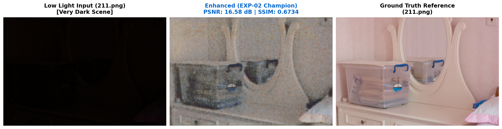
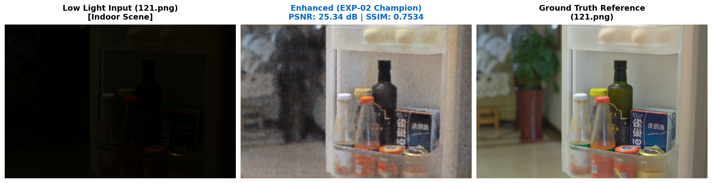
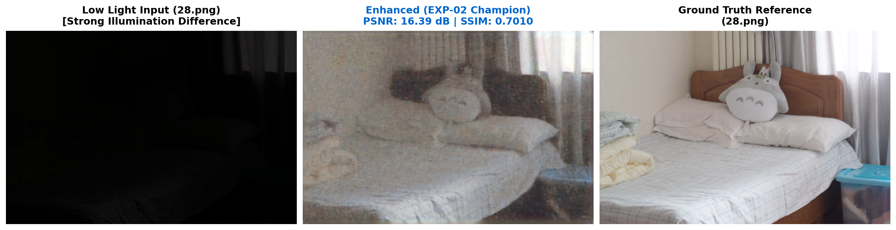

# Low-Light Image Enhancement (LOL Benchmark)

A controlled normalization ablation study diagnosing and resolving distributed small-batch training instability in deep convolutional low-light enhancement networks.

---

## 1. Project Overview & Problem Statement

Low-light image enhancement aims to restore visibility, color balance, and edge contrast from severely underexposed digital photographs while suppressing sensor noise. 

This repository investigates and stabilizes an end-to-end enhancement pipeline evaluated on the paired **LOL (Low-Light) dataset** (485 paired images at native $600 \times 400$ resolution). Rather than introducing architectural complexity, this project demonstrates how an empirical diagnosis of normalization dynamics under distributed multi-GPU training can yield significant metric gains and stable convergence.

---

## 2. Baseline Architecture & Setup

The baseline model is a 31.04-million parameter network comprising:
1. **Downsampler**: `Conv2d(3, 3, kernel_size=3, stride=2, padding=1)` reducing spatial dimensions to $200 \times 300$.
2. **Pointwise MLP Blocks**: 6 cascaded feature adapter blocks ($1 \times 1$ convolutions with GELU and Sigmoid gating) operating at reduced resolution.
3. **Upsampler**: `ConvTranspose2d(3, 3, kernel_size=4, stride=2, padding=1)` restoring the feature map to $400 \times 600$.
4. **U-Net Backbone**: A 4-stage symmetric encoder-decoder with skip connections and channel widths `[64, 128, 256, 512]` performing direct image synthesis.

### Distributed Training Setup:
- **Compute**: 2× NVIDIA Tesla T4 GPUs on Kaggle via PyTorch DistributedDataParallel (DDP) with NCCL backend.
- **Batching**: Per-GPU batch size of 2, producing an effective global batch size of 4 ($2 \times 2$).
- **Optimizer**: Adam ($\beta_1=0.9, \beta_2=0.999$, weight decay=0).
- **Learning Rate**: Initial $lr = 1 \times 10^{-4}$ with `CosineAnnealingLR` ($T_{\text{max}} = 15, \eta_{\text{min}} = 1 \times 10^{-6}$).
- **Loss**: Mean Squared Error (MSE).
- **Split**: Fixed, persisted 435 train / 50 validation split (`splits/split_seed42.json`, seed 42, zero leakage).
- **Evaluation**: Unwarped native $600 \times 400$ resolution with dynamic range clamping strictly to $[0.0, 1.0]$. Metrics computed: Peak Signal-to-Noise Ratio (PSNR, $\text{MAX}=1.0$) and Structural Similarity Index (SSIM, $11 \times 11$ Gaussian window, $\sigma=1.5$).

---

## 3. Diagnosis: Small-Batch BatchNorm Instability

In the initial implementation, all 18 normalization layers across the U-Net double-convolution blocks used standard Batch Normalization (`nn.BatchNorm2d`).

When training with PyTorch DDP across 2 GPUs with a local batch size of $N=2$ per GPU:
- Each process computes batch mean $\mu_B$ and batch variance $\sigma_B^2$ over only 2 images.
- Low-light images exhibit high variance in mean luminance and color histograms across different dark indoor/outdoor scenes.
- Computing batch statistics across $N=2$ samples caused massive variance in running normalization statistics.
- **Symptom**: During training, validation loss suffered severe instability and divergence spikes (at Epoch 6, validation MSE spiked to `0.108738`, with PSNR dropping to `10.08 dB` and SSIM to `0.1480`). Even as training loss decreased monotonically, validation PSNR plateaued prematurely at **18.03 dB** (final: 17.92 dB, SSIM: 0.6650, MSE: 0.024842).

---

## 4. Controlled Improvement: Instance Normalization Ablation

To resolve the small-batch statistical divergence without adding parameters or changing training dynamics:
- **Hypothesis**: Low-light enhancement is primarily an instance-specific contrast and luminance mapping task. Computing mean and variance independently per sample and per channel eliminates dependency on batch statistics, insulating the network from small-batch sampling variance.
- **Single-Variable Modification**: Replace all 18 `nn.BatchNorm2d(channels)` layers with `nn.InstanceNorm2d(channels, affine=True)`.
- **Strict Controls Kept Unchanged**:
  - 0 change to U-Net topology, bottleneck, or skip connections
  - 0 change to channel widths (`[64, 128, 256, 512]`)
  - 0 change to downsampler, MLP stack, or upsampler
  - 0 change to loss function, optimizer, learning rate, or scheduler
  - 0 change to effective batch size (4) or DDP setup (2× T4)
  - 0 change to dataset split, seed (42), or evaluation metrics
  - Total parameter count remains exactly **31,044,152**.

---

## 5. Measured Results

Training from scratch for 15 epochs under identical configurations produced immediate and dramatic stabilization:

| Metric | Baseline (`BatchNorm2d`) | Final Accepted Model (`InstanceNorm2d`) | Absolute Gain |
|:---|:---:|:---:|:---:|
| **Best Validation PSNR** | 18.03 dB | **19.98 dB** | **+1.95 dB** |
| **Final Validation PSNR** | 17.92 dB | **19.96 dB** | **+2.04 dB** |
| **Best Validation SSIM** | 0.6697 | **0.7159** | **+0.0462** |
| **Final Validation SSIM** | 0.6650 | **0.7097** | **+0.0447** |
| **Final Validation MSE** | 0.024842 | **0.012301** | **-50.5% error reduction** |
| **Final Train Loss (MSE)** | 0.01432 | **0.01009** | **-29.5% error reduction** |
| **Convergence Behavior** | Severe oscillations / spikes | Smooth, monotonic improvement | Stabilized |
| **Total Parameters** | 31,044,152 | 31,044,152 | Unchanged (0 params added) |

### Key Takeaway:
Replacing `BatchNorm2d` with `InstanceNorm2d(affine=True)` eliminated the severe validation instability observed with `BatchNorm2d`, resulting in a **+1.95 dB improvement in validation PSNR**, a **+0.0462 improvement in validation SSIM**, and a **50.5% reduction in final validation MSE** (0.024842 $\to$ 0.012301) with zero additional parameters or computational overhead.

---

## 6. Qualitative Results

Representative enhancement outputs produced by the final EXP-02 model on the fixed 50-image validation set (`splits/split_seed42.json`) evaluated at native $600 \times 400$ resolution:

### Case 1: Very Dark Scene (`211.png` — Severe Underexposure, Input Mean Luminance: 0.0145)


### Case 2: Indoor Scene (`121.png` — Indoor Lighting & Fine Structure)


### Case 3: Strong Illumination Difference (`28.png` — $39.6\times$ Dynamic Range Expansion)


A comprehensive evaluation and visualization notebook covering all representative categories is provided in [`notebooks/results.ipynb`](notebooks/results.ipynb).

---

## 7. Repository Structure

```
.
├── assets/
│   └── results/           # Qualitative result panels and comparison figures
├── notebooks/
│   └── results.ipynb      # Official qualitative & quantitative evaluation notebook
├── src/
│   ├── model.py           # Final accepted PixelWarriorNetwork (InstanceNorm2d)
│   ├── dataset.py         # PyTorch Dataset for paired low/high-light images
│   ├── metrics.py         # Clamped PSNR, SSIM, and MSE implementations
│   ├── evaluate.py        # Standalone validation evaluation script
│   ├── train.py           # Single-GPU training script
│   └── utils.py           # Reproducibility seeds and helpers
├── tests/
│   ├── test_model.py          # Unit tests for parameter counts, layer types, and forward pass
│   └── test_ddp_and_split.py  # Tests for DistributedSampler partitioning and split integrity
├── splits/
│   ├── split_seed42.json  # Persisted 435 train / 50 val split (seed 42)
│   ├── train_files.txt    # 435 training file names
│   └── val_files.txt      # 50 validation file names
├── kaggle_train.py        # Distributed multi-GPU (2x T4 DDP) training entry point
├── kaggle_canonical_baseline.ipynb # Self-contained Kaggle baseline notebook
├── PROGRESS_LOG.md        # Comprehensive append-only experiment history
└── README.md              # Project documentation
```

---

## 8. Setup & Reproduction

### Prerequisites
- Python 3.9+
- PyTorch 2.0+ with CUDA support
- Torchvision, Pillow, NumPy, Matplotlib, TQDM


```bash
pip install torch torchvision pillow numpy matplotlib tqdm
```

### Running Unit Tests
```bash
# Verify model architecture, parameter count (31,044,152), and InstanceNorm layers
python tests/test_model.py

# Verify DDP DistributedSampler partitioning (World Size=2) and split integrity
python tests/test_ddp_and_split.py
```

### Running Multi-GPU Training (PyTorch DDP)
```bash
torchrun --nproc_per_node=2 kaggle_train.py \
    --dataset_root /path/to/dataset \
    --split_json splits/split_seed42.json \
    --epochs 15 \
    --per_gpu_batch_size 2 \
    --lr 0.0001 \
    --seed 42 \
    --output_dir experiments/accepted_model
```

### Running Evaluation
```bash
python src/evaluate.py \
    --dataset_root /path/to/dataset \
    --checkpoint_path /path/to/checkpoint.pth \
    --split_json splits/split_seed42.json \
    --device cuda
```

---

## 9. Technical Stack

- **Framework**: PyTorch (`torch.nn`, `torch.optim`, `torch.distributed`)
- **Distributed Engine**: PyTorch DistributedDataParallel (DDP) with `NCCL` backend
- **Hardware**: 2× NVIDIA Tesla T4 GPUs (Kaggle Cloud)
- **Evaluation Metrics**: Peak Signal-to-Noise Ratio (PSNR), Structural Similarity Index (SSIM), Mean Squared Error (MSE)
- **Computer Vision**: Torchvision, PIL (Pillow)
- **Tracking**: Dual-level DDP-safe TQDM progress logging
